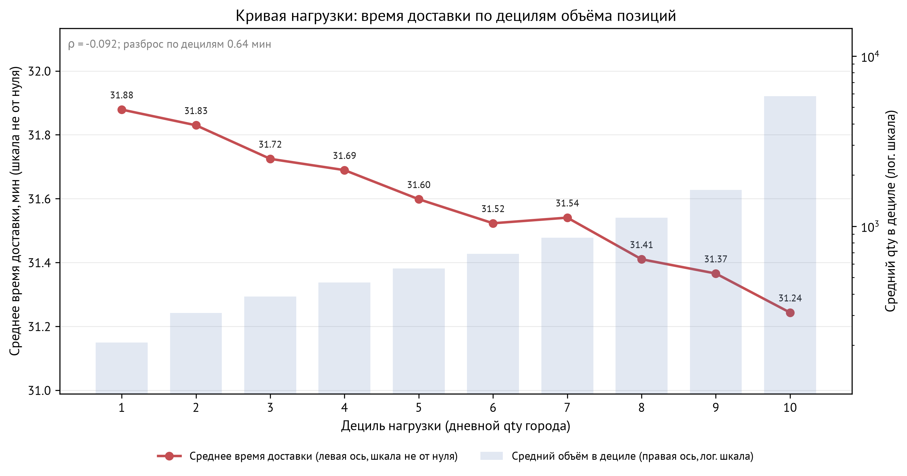

<!-- ascii-art: pyfiglet + ascii-bin (CC0) -->
```text
 _| _ |o   _ .____ _ .__|_.__ |___|_ _      _ ._
(_|(/_||\/(/_|\/(_(_)| ||_|(_)|   |_(_)\/\/(/_|
              /

╭──────────────────────────────────────────────────────────────────────────╮
│ Аналитика доставки на полугодовом агрегате заказов: воспроизводимый ETL, │
╰──────────────────────────────────────────────────────────────────────────╯
━━━━━━━━━━━━━━━━━━━━━━━━━━━━━━━━━━━━━━━━━━━━━━━━━━━━━━━━━━━━━━━━━━━━━━━━━━━━
```

# Delivery Control Tower

Аналитика доставки на полугодовом агрегате заказов: воспроизводимый ETL,
звёздная схема в DuckDB, прогноз объёма заказов, разбор узких мест во времени
доставки, две предзарегистрированные гипотезы, слой SQL с оконными функциями и
замеренными оптимизациями, офлайн-дашборд для каждой роли.

Предзарегистрированные гипотезы — это гипотезы, сформулированные до расчёта: так
подгонка под результат видна сразу.

Проект отвечает на один операционный вопрос: где процесс доставки теряет время
и хватает ли точности прогноза, чтобы планировать нагрузку на этот объём. Ответ
— в числах, которые вы перезапустите из CSV в `reports/`.

**Public link:** [живой дашборд](https://nikitaboyarkin.github.io/delivery-control-tower/) · [кейс](https://nikitaboyarkin.github.io/projects/delivery/) · [исходники](https://github.com/NikitaBoyarkin/delivery-control-tower)

**▶ [Схема: конвейер данных и контроль качества](docs/diagrams/delivery-control-tower.svg)** — открывается в браузере, без установки и сборки
## Что показывает

| Слой | Что показывает |
|---|---|
| Инженерия данных | Сырые CSV → staging в parquet → звёздная схема в DuckDB; каждая проверка качества — именованное утверждение с сохранённым значением |
| Прогноз | Бэктест со скользящим началом (окно теста 28 дней, переобучение каждые 7 дней, четыре фолда) для четырёх моделей на горизонтах 1, 7 и 14 дней; метрики WAPE и MASE |
| Операционный анализ | Декомпозиция времени доставки по каналу × категории, кривая нагрузки по децилям объёма, наклон деградации по каждому городу и составной индекс деградации |
| Статистика | Критерий Манна — Уитни с бутстреп-доверительными интервалами; гипотеза считается подтверждённой, только если интервал не содержит нуля |
| SQL | 14 запросов с оконными функциями в виде именованных блоков и три пары «медленно/быстро» с замером через `EXPLAIN ANALYZE` |
| Подача | Один самодостаточный HTML-дашборд (без CDN и запросов из браузера) с тремя блоками — по одному на роль; плюс [публичная страница](https://nikitaboyarkin.github.io/delivery-control-tower/) с глобальными фильтрами канала и категории |

Бэктест — это проверка прогноза на исторических окнах, фолд — один такой прогон.
WAPE — взвешенная абсолютная процентная ошибка, MASE — ошибка модели в долях от
ошибки наивного прогноза.

## Данные и оговорки

Источник — агрегат из тестового задания для аналитика (Dodo Brands):
**день × город × канал × категория** за **2022-01-01..2022-06-30**. В нём
**550 710 строк**, **264 города**, **3 канала** (`mp`, `web`, `other`) и
**4 категории**. Второй файл — выборка на уровне заказов: **130 079 заказов**
по **2 анонимизированным городам**.

Прежде чем называть любую цифру, прочитайте оговорки:

- `tickets` — заказы (чеки), а не обращения в поддержку. `SUM(tickets)` за
  период — 33 167 293.
- `qty` — позиции: всего 57 576 550, или 1.736 позиции на заказ.
- `cost` — деньги в **неподтверждённых единицах источника**. Валюту в данных
  никто не описал, и ничто не доказывает, что это выручка. Везде подписано
  «cost, ед. источника» и нигде не названо выручкой или рублями.
- `avg_price` не сходится с `SUM(cost) / SUM(tickets)` (221.8 против 138.9).
  Семантику подтвердить нечем, поэтому в расчётах он **не участвует**.
- `clients_qty` — уникальные клиенты внутри ячейки. Сумма по ячейкам не даёт
  уникальных клиентов за период.
- `avg_time` — среднее по ячейке в минутах. При агрегации за период его
  взвешивают по `qty`, а обычный `AVG` брать нельзя.

Полный словарь полей — в
[data_dictionary.md](docs/data_dictionary.md).

## Архитектура

```text
data/raw/*.csv                     исходные агрегаты, копия как есть
        │  delivery.etl           типы и календарь → parquet
        ▼
data/staging/*.parquet             sales_daily, orders
        │  delivery.quality       именованные проверки качества
        │  delivery.marts         звёздная схема и витрины
        ▼
data/marts/delivery.duckdb
        dim_date · dim_city · dim_channel · dim_category
        dim_client · dim_order_city
        fact_sales (день × город × канал × категория)
        fact_orders (выборка)
        mart_daily_total · mart_city_daily · mart_delivery
        │
        ├─ delivery.forecast      4 модели × 3 горизонта, бэктест
        ├─ delivery.bottlenecks   канал × категория, децили, города
        ├─ delivery.hypothesis    H1 каналы, H2 выходные, бутстреп
        ├─ delivery.sql_layer     14 оконных запросов + 3 пары
        ├─ delivery.dashboard     офлайн-HTML → reports/dashboard.html
        └─ delivery.dashboard_pages  публичный HTML → docs/index.html (GitHub Pages)
```

`delivery/` — обычный пакет модулей, оркестратора вроде Airflow в проекте нет.
Каждый шаг идемпотентен: промежуточные слои (`etl`, `quality`, `marts`) пишут в
`data/`, аналитические артефакты — в `reports/`. Исключение — публичная страница:
`delivery.dashboard_pages` собирает `docs/index.html` из тех же витрин, и именно
эту папку публикует GitHub Pages.

## Быстрый старт

Нужен Python 3.12 — на нём проект тестируется и он закреплён в `.python-version`;
в `pyproject.toml` объявлен минимум `>=3.11`, которому 3.12 удовлетворяет.
Зависимости ставит `uv`.

**Пайплайн воспроизводится только с двумя исходными CSV, а они не
публиковались** — их нет ни в репозитории, ни по внешней ссылке (см.
[docs/data_sources.md](docs/data_sources.md)): `data/raw/city_day_channel_category.csv`
и `data/raw/orders_sample.csv`. Без них `delivery.etl` и всё, что ниже по
схеме, не запустится, а тесты витрин пропустятся. Без данных можно проверить
закоммиченные артефакты в `reports/`: `report.md`, `ab_test_analysis.md`,
`dashboard.html`, `forecast_metrics.csv`, `hypothesis_results.csv`,
`bottleneck_channels.csv`, `bottleneck_cities.csv`. Публичная страница
`docs/index.html` тоже закоммичена: она самодостаточна, открывается без сервера
и пересобирается шагом `delivery.dashboard_pages` из витрин DuckDB.

```bash
uv sync --all-groups          # зависимости для работы и тестов
uv run python -m delivery.etl
uv run python -m delivery.marts
uv run python -m delivery.forecast
uv run python -m delivery.bottlenecks
uv run python -m delivery.hypothesis
uv run python scripts/ab_test_analyzer.py --readout all   # SRM, мощность, H1/H2
uv run python -m delivery.sql_layer   # оконные запросы и замеры
uv run python -m delivery.dashboard   # → reports/dashboard.html (офлайн, три роли)
uv run python -m delivery.dashboard_pages   # → docs/index.html (публичная страница)
uv run pytest                         # 87 тестов
uv run ruff check delivery/ tests/
```

`delivery.etl` ждёт два исходных CSV в `data/raw/`. Если файлы уже на месте,
остальные шаги идут сами.

**Данные** — исходных CSV в репозитории нет: вместе они весят около 85 МБ.
Положите их в `data/raw/` как `city_day_channel_category.csv` и
`orders_sample.csv` или укажите в `DELIVERY_RAW_SOURCE` папку с оригиналами
(`оценка_категорий_4.csv` и `DA_sql_sample - sql_task.csv`) — `delivery.etl`
скопирует их сам. Непустой `data/raw/` всегда главнее: копирование в этом
случае пропускается, и свежему клону с готовыми CSV исходная папка не нужна.

Контрольные суммы, размеры и происхождение файлов — в
[docs/data_sources.md](docs/data_sources.md). Из репозитория их восстановить
нельзя: `delivery.etl` копирует готовые файлы, а не создаёт их.

Тесты витрин читают `data/marts/delivery.duckdb`. На чистой машине сначала
запустите `uv run python -m delivery.marts`, иначе эти тесты пропустятся.

## Результаты

### Прогноз заказов: WAPE по горизонтам (%, четыре фолда)

| Модель | h = 1 | h = 7 | h = 14 |
|---|---:|---:|---:|
| `naive` | 22.68 | 12.53 | 12.54 |
| `seasonal_naive` | 5.40 | **6.01** | **6.25** |
| `holt_winters` | **3.91** | 7.16 | 7.22 |
| `hgb` (градиентный бустинг) | 7.14 | 7.90 | 8.09 |

На горизонте в один день выигрывает Holt-Winters (3.91%), а на семи и
четырнадцати днях — недельная сезонная наивная модель (6.01% и 6.25%).
Градиентный бустинг не обгоняет сезонный бейзлайн ни на одном горизонте.

### Три находки

1. **Время доставки определяется категорией, а не загрузкой.** Общая
   корреляция Спирмена между дневным объёмом города и временем доставки —
   **ρ = −0.092**; среднее время меняется с 31.88 минуты в нижнем дециле
   объёма до 31.24 минуты в верхнем. Внутри одного канала снеки идут
   **≈39.95–39.99 минуты** против пиццы **≈26.49–26.56 минуты** — примерно
   **+13.4 минуты (около 50%)**. Разрыв постоянен во всех каналах и при любом
   размере корзины (13.1–13.7 минуты), а дневные колебания времени пиццы и
   снеков внутри одного города почти не связаны (r = 0.002). Это сигнатура
   различия в определении метрики по категориям, а не измеренного эффекта
   процесса: причину на этих данных установить нельзя, и дальше описания
   разрыва вывод не идёт.

   
   *Что показано: кривая нагрузки — среднее время доставки по десяти децилям дневного объёма города, 31,88 минуты в нижнем дециле против 31,24 в верхнем, при ранговой корреляции ρ = −0.092; линия плоская, то есть роста времени с нагрузкой нет. Оговорка: данные уже агрегированы до «день × город × канал × категория», поэтому это описание ассоциации на наблюдаемых агрегатах, а не эффект процесса.*

2. **Канальный микс смещается в маркетплейс.** Доля `mp` в паре `mp + web`
   растёт с **81.9% в январе до 87.6% в июне** (**+5.7 п. п.**, p = 2.1e-11,
   бутстреп-интервал [5.35; 6.03]).
3. **SQL окупается при переписывании.** Из трёх пар «медленно/быстро» первая —
   накопленный счёт заказов по 130 079 строкам — ускоряется в **4–5 раз**
   (медиана повторов после прогрева); пара на ярлыке выручки держит **3.0×**;
   пара на сроке жизни клиента (31 426 строк) даёт **1.3–2.2×**, то есть лежит
   на границе шума: оба варианта считаются за единицы миллисекунд, и знак
   разницы меняется между прогонами. Все 14 оконных запросов укладываются в
   200 мс, самый медленный — активные клиенты за 30 дней, около 120 мс. Время
   настенное, на одной машине; ускорения — порядок величины, а не точная
   цифра; значения прогона — в `reports/sql_optimization.csv` и
   `reports/sql_timings.csv`.

### Один честный отрицательный результат — и ошибка в метрике

**По выходным доставка не медленнее.** Предзарегистрированная гипотеза H2
отклонена: медианное время доставки в городе-дне — **31.37 минуты
в выходные против 31.66 в будни (−0.93%)**, p = **1.1e-41**,
95%-интервал эффекта **[−1.09; −0.76] п. п.** (в минутах: [−0.345; −0.241]),
n = 13 720 / 34 030. Интервал и p посчитаны наивным бутстрепом по строкам
city-day; при кластеризации по дате или городу интервал шире, а p-value на
порядки выше. Направление и решение по H2 от этого не меняются, но точную
величину p читайте как верхнюю границу уверенности, а не как измерение. Эффект значим, но
противоположен гипотезе, поэтому это отклонение, а не подтверждение: правило
вердикта и запись о регистрации — в `docs/preregistration.md`, расчёт — в
`delivery/hypothesis.py`.

Эти числа появились после исправления метрики. `mart_city_daily.avg_time`
считался как `AVG(avg_time)`, хотя `avg_time` — отношение (время / заказы),
и `docs/data_dictionary.md` требует взвешивать по `qty`. Невзвешенное среднее
давало нулевой результат (p = 0.617), взвешенное — эффект в обратную сторону.
Дефект закрыт регресс-тестом `tests/test_marts.py::test_city_time_is_qty_weighted_not_averaged`.

У прогноза есть второй честный минус: модель машинного обучения не обгоняет
сезонный бейзлайн, и для h = 7 и h = 14 проект рекомендует именно бейзлайн,
а не более сложную модель.

## Что это доказывает

- **Метрику можно перепроверить, а не принять на веру.** Взвешивание
  `avg_time` по `qty` вместо `AVG(avg_time)` переворачивает вывод по H2, и этот
  дефект закрыт регресс-тестом
  `tests/test_marts.py::test_city_time_is_qty_weighted_not_averaged` — разбор в
  разделе «Один честный отрицательный результат — и ошибка в метрике».
- **Весь конвейер проверяется одной командой.** `uv run pytest` — 87 тестов по
  слоям: `tests/test_etl.py`, `tests/test_marts.py`, `tests/test_forecast.py`,
  `tests/test_hypothesis.py`, `tests/test_sql_layer.py`,
  `tests/test_dashboard.py`, `tests/test_dashboard_pages.py`.
- **Гипотезы зафиксированы до вердикта, и граница фиксации названа.**
  `docs/preregistration.md` показывает коммит `2af3ea1`, исходные тексты H1/H2
  и правило вердикта; сами числа — `reports/hypothesis_results.csv`, код —
  `delivery/hypothesis.py`.
- **Куда переносится:** операционный агрегат с честными оговорками о
  гранулярности — бэктест прогноза (WAPE и MASE), поиск узкого места во времени
  процесса и проверка гипотезы без причинных претензий. Замеры SQL лежат рядом:
  `reports/sql_timings.csv` и `reports/sql_optimization.csv`.

## Структура проекта

```text
delivery/
  config.py         пути и общие константы
  etl.py            сырые CSV → staging parquet, календарь
  quality.py        именованные проверки качества данных
  marts.py          звёздная схема и витрины в DuckDB
  forecast.py       бэктест со скользящим началом, WAPE и MASE
  bottlenecks.py    канал × категория, кривая нагрузки, города
  hypothesis.py     H1 и H2: Манн — Уитни и бутстреп-интервал
  sql_layer.py      оконные запросы + EXPLAIN ANALYZE
  dashboard.py      офлайн-HTML, только встроенный SVG
  dashboard_pages.py публичный HTML для GitHub Pages → docs/index.html
sql/
  windows.sql            14 именованных оконных запросов
  optimization.sql       3 пары «медленно/быстро»
  indexes_postgres.sql   индексы для развёртывания в Postgres
superset/          рецепт docker-compose, не проверен
scripts/
  ab_test_analyzer.py     SRM, мощность/MDE, кластерный бутстреп по H1 и H2
docs/data_dictionary.md
reports/           CSV-артефакты, графики, dashboard.html — офлайн-дашборд
                   с тремя блоками по ролям (delivery/dashboard.py),
                   ab_test_analysis.md (ридаут H1/H2), ab_test_metrics.csv
docs/index.html    публичная страница на GitHub Pages: один Power BI-style
                   дашборд с фильтрами (delivery/dashboard_pages.py)
tests/             87 тестов pytest
```

## Ограничения

- **Агрегатная гранулярность** — данные уже свёрнуты до
  «день × город × канал × категория». В них нет времени по отдельному заказу,
  нет курьера и ресторана, поэтому декомпозиция времени доставки
  останавливается на уровне категории.
- **Выборка заказов покрывает два анонимизированных города** — она нужна
  только слою SQL и не годится для выводов по городам.
- **У `cost` нет подтверждённой валюты**, поэтому он не считается выручкой.
  `avg_price` не используется по той же причине.
- **Наклоны деградации по городам слабые** — у города на первом месте (Усолье-Сибирское,
  индекс деградации 2.02) R² наклона 0.0139, так что рейтинг помогает
  расставить приоритеты, но не доказывает тренд по городу.
- **Четыре фолда бэктеста** — WAPE оценён на 28-дневном окне теста с четырьмя
  переобучениями, поэтому выборка для сравнения моделей узкая, а разницу
  в несколько десятых пункта не стоит читать как решённую.
- **Рецепт Superset так и не запускали** — Docker на машине сборки недоступен,
  поэтому `superset/docker-compose.yml` и `init_superset.sh` написаны, но не
  проверены: ни запуска, ни скриншотов, ни подтверждённого подключения.
  Проверенный артефакт — статический дашборд.
- **Причинных выводов нет** — гипотезы проверяют связь на наблюдаемых
  агрегатах, а эффект воздействия такой дизайн не выделяет.
