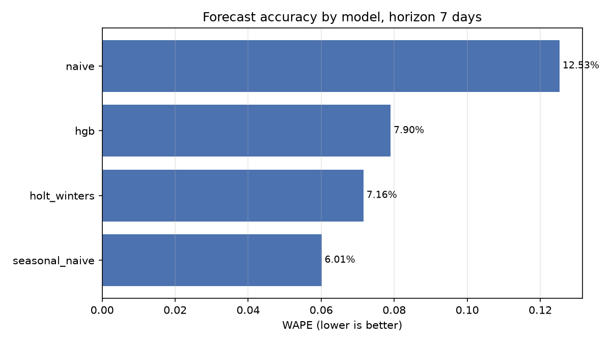
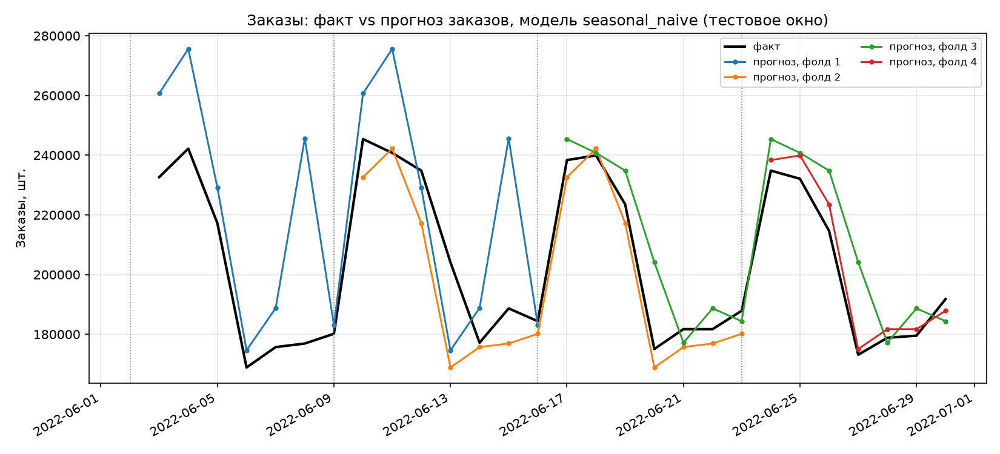
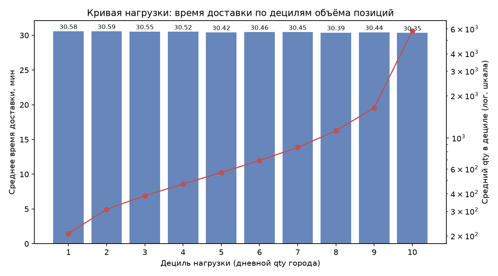
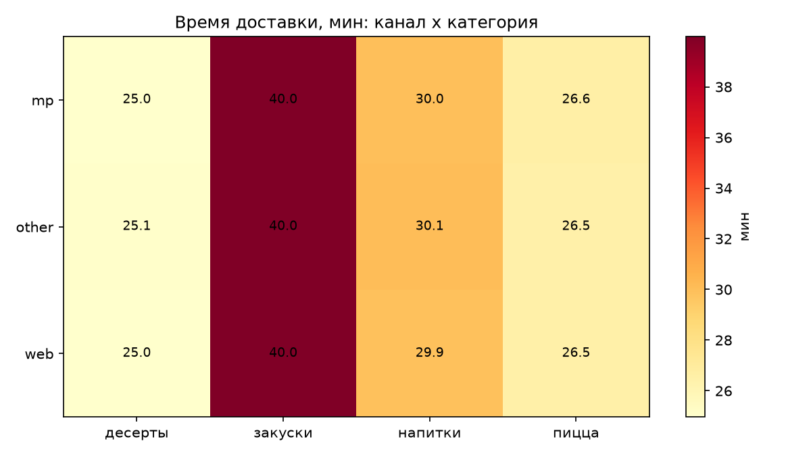
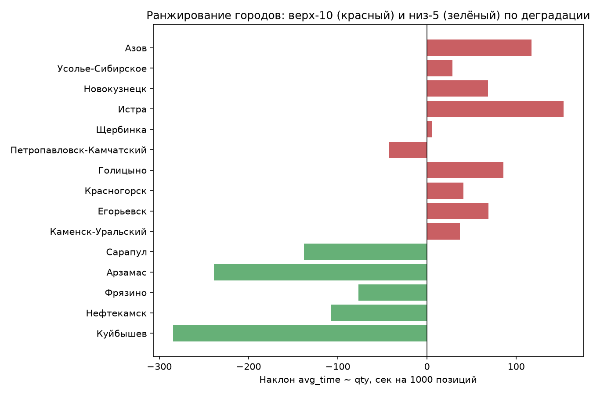
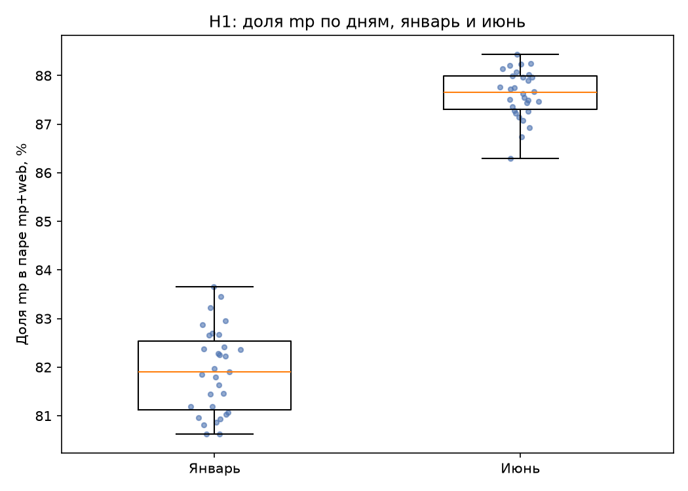
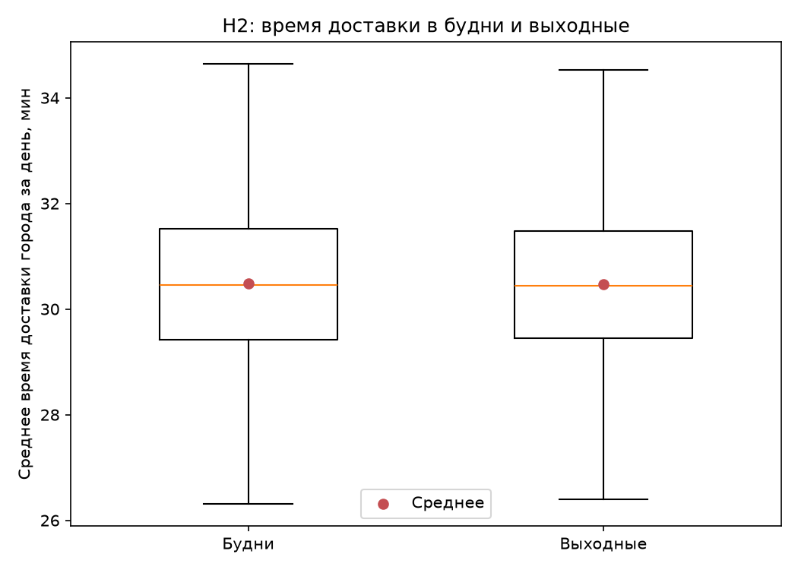

# Delivery Control Tower — аналитический отчёт

## 1. Задача и данные

Задача — понять, где процесс доставки теряет время и можно ли прогнозировать
объём заказов достаточно точно, чтобы планировать под него загрузку.

Источник — агрегат из открытого тестового задания (Dodo Brands):
**день × город × канал × категория** за **2022-01-01 .. 2022-06-30**,
**550 710 строк**, **264 города**, **3 канала** (`mp`, `web`, `other`),
**4 категории** (пицца, закуски, напитки, десерты), 181 день. Второй файл —
сэмпл **130 079 заказов** по **2 анонимным городам**, он используется только
для SQL-слоя.

Семантика полей, принятая в работе:

| Поле | Что значит | Проверка |
|---|---|---|
| `tickets` | заказы (чеки), не обращения в поддержку | `SUM(tickets)` = 33 167 293; `SUM(qty)/SUM(tickets)` = 1.736 |
| `qty` | позиции (блюда) | `SUM(qty)` = 57 576 550 |
| `clients_qty` | уникальные клиенты внутри ячейки | `SUM(clients_qty)/SUM(tickets)` = 0.94 |
| `cost` | денежная метрика источника | `SUM(cost)/SUM(tickets)` = 138.9; **валюта не подтверждена** |
| `avg_price` | средняя цена из источника | не согласуется с `cost` (221.8 против 138.9) — **не используется** |
| `avg_time` | время доставки, минуты | при агрегации взвешивается по `qty` |

`cost` нигде не называется выручкой: это денежная метрика в неподтверждённых
единицах источника. Полный словарь — `docs/data_dictionary.md`.

## 2. Как устроен пайплайн

| Слой | Модуль | Что делает |
|---|---|---|
| Raw → staging | `delivery/etl.py` | копирует исходные CSV, нормализует типы, добавляет календарные колонки, пишет parquet |
| Контроль качества | `delivery/quality.py` | именованные проверки: число строк, уникальность гранулярности, диапазоны дат |
| Star schema | `delivery/marts.py` | `dim_date`, `dim_city`, `dim_channel`, `dim_category`, `dim_client`, `dim_order_city`, `fact_sales`, `fact_orders` и витрины `mart_daily_total`, `mart_city_daily`, `mart_delivery` в DuckDB |
| Прогноз | `delivery/forecast.py` | rolling-origin бэктест: тестовое окно 28 дней, 4 фолда, переобучение каждые 7 дней, горизонты 1/7/14 |
| Узкие места | `delivery/bottlenecks.py` | декомпозиция времени по каналу × категории, кривая нагрузки по децилям объёма, наклон деградации по городам |
| Гипотезы | `delivery/hypothesis.py` | Mann-Whitney U + bootstrap-интервал; гипотеза считается подтверждённой только если p < α **и** интервал не содержит ноль |
| SQL-слой | `delivery/sql_layer.py` | 14 именованных оконных запросов, 3 пары оптимизаций под `EXPLAIN ANALYZE` |
| Презентация | `delivery/dashboard.py` | один самодостаточный HTML без CDN и клиентских запросов, inline-SVG |

Все стадии идемпотентны и складывают артефакты в `reports/`.

## 3. Результаты по блокам

### 3.1 Прогноз заказов

WAPE по горизонтам (%, четыре фолда, `reports/forecast_metrics.csv`):

| Модель | h=1 | h=7 | h=14 |
|---|---:|---:|---:|
| naive | 22.68 | 12.53 | 12.54 |
| seasonal_naive | 5.40 | **6.01** | **6.25** |
| holt_winters | **3.91** | 7.16 | 7.22 |
| hgb | 7.14 | 7.90 | 8.09 |



Holt-Winters выигрывает день вперёд (3.91%), но на неделе и двух неделях
лучший результат у недельной сезонной наивной модели (6.01% и 6.25%).
Градиентный бустинг не обходит сезонный бейзлайн ни на одном горизонте.



### 3.2 Узкие места

**Нагрузка почти не влияет на время.** Объединённая корреляция Спирмена между
дневным объёмом города и временем доставки — **ρ = −0.092**. По децилям объёма
среднее время меняется с 31.88 мин в первом дециле до 31.24 мин в десятом
(`reports/load_curve.csv`): разница 0.64 мин при росте объёма почти в 28 раз.



**Категория влияет сильнее канала.** Внутри каждого канала закуски идут
≈39.95–39.99 мин, пицца — ≈26.49–26.56 мин, то есть разрыв около **+13.4 мин
(+50%)**. Канал меняет время в пределах десятых долей минуты
(`reports/bottleneck_channels.csv`):

| Категория | mp | web | other |
|---|---:|---:|---:|
| пицца | 26.56 | 26.55 | 26.49 |
| закуски | 39.97 | 39.99 | 39.95 |
| напитки | 30.00 | 29.85 | 30.05 |
| десерты | 24.98 | 24.97 | 25.05 |



**Рейтинг городов по деградации.** Индекс строится из наклона
`avg_time ~ qty` (секунд на 1000 заказов) и разбивает города на `worst10`,
`middle` (249 городов) и `best5`. Верхушка `worst10`
(`reports/bottleneck_cities.csv`):

| Ранг | Город | Индекс деградации | R² наклона |
|---:|---|---:|---:|
| 1 | Усолье-Сибирское | 2.02 | 0.0139 |
| 2 | Грозный | 1.63 | 0.0292 |
| 3 | Магадан | 1.18 | 0.0004 |
| 4 | Новый Уренгой | 1.08 | 0.0059 |
| 5 | Благовещенск | 1.02 | 0.0412 |



Низкие R² — важная часть результата: рейтинг задаёт порядок проверки городов,
но сам по себе не доказывает устойчивый тренд роста времени в конкретном городе.

### 3.3 Гипотезы

| Гипотеза | Эффект | p-value | 95% CI | Вывод |
|---|---|---:|---|---|
| H1: доля `mp` растёт быстрее `web` | +5.70 п.п. | 2.07e-11 | [5.35; 6.03] | подтверждена |
| H2: выходные медленнее будней | −0.93% | 1.08e-41 | [−1.09; −0.76] | **отклонена: эффект значим в обратную сторону** |

H1: доля `mp` внутри пары `mp + web` растёт с 81.9% в январе до 87.6% в июне,
n = 30 / 31 день. Доля `web` падает на те же 5.7 п.п. по построению.



H2: медиана на city-day — 31.37 мин в выходные против 31.66 мин в будни,
n = 13 720 / 34 030. Интервал не содержит ноль, p = 1.08e-41, но знак
противоположен гипотезе: по выходным доставка быстрее на 0.29 мин. Правило
«значимый эффект в обратную сторону — это отклонение» зафиксировано в
`delivery/hypothesis.py` и покрыто тестом
`test_h2_rejects_significant_effect_in_wrong_direction`.

Числа H2 считаются по метрике, взвешенной по `qty`: `avg_time` — отношение
(время / заказы), и словарь данных запрещает усреднять его без веса. Прежняя
невзвешенная версия (`AVG(avg_time)` в `mart_city_daily`) давала p = 0.617 при
эффекте −0.02%; дефект закрыт, регресс-тест —
`tests/test_marts.py::test_city_time_is_qty_weighted_not_averaged`.



### 3.4 SQL-слой

14 оконных запросов (`sql/windows.sql`): скользящее среднее, недельный рост,
накопительный итог, квартили дневного объёма, ранги городов по месяцам и по
времени доставки, Парето по городам, аномальные дни по правилу 3×MA7, разрывы
между заказами клиента. Самый тяжёлый — 30-дневный подсчёт активных клиентов,
195.95 мс; остальные укладываются в 28 мс (`reports/sql_timings.csv`).

Три пары «медленный / быстрый» вариант (`reports/sql_optimization.csv`):

| Пара | Строк | Медленный | Быстрый | Ускорение |
|---|---:|---:|---:|---:|
| running_order_count | 130 079 | 62.3 мс | 11.0 мс | **5.66×** |
| monthly_revenue_label | 6 | 8.4 мс | 2.6 мс | 3.23× |
| client_lifetime_revenue | 31 426 | 5.7 мс | 4.5 мс | 1.27× |

Лучшее ускорение — **5.66×** на накопленном счётчике заказов по 130 079
строкам. Замеры сняты под `EXPLAIN ANALYZE` на одной машине и одном датасете:
wall-clock, медиана 3 прогонов после одного прогрева. Между прогонами разброс
до ±30%, поэтому ускорения подаются как порядок величины, а не точное число;
это сравнение вариантов запроса, а не бенчмарк СУБД.

### 3.5 Дашборд

`reports/dashboard.html` — один файл ≈81 КБ, открывается офлайн, без CDN и
клиентских запросов, графики — inline-SVG. Три блока по ролям:

| Блок | Роль | Содержание |
|---|---|---|
| 01 | операционный менеджер | заказы, позиции, скорость доставки |
| 02 | коммерческий аналитик | каналы и категории: где заказы, время и позиции на заказ |
| 03 | руководитель направления | тренд по неделям, концентрация по городам, Парето |

Superset-рецепт (`superset/`) написан, но **не проверен**: Docker на машине не
запускался, ни одного запуска и подтверждённого подключения нет. Проверенный
артефакт — статический дашборд.

## 4. Что НЕ подтвердилось

1. **Выходные не медленнее будней (H2).** p = 1.08e-41, эффект −0.93%,
   CI [−1.09; −0.76] — значимый эффект в обратную сторону. Гипотеза
   сформулирована до расчёта и отклонена по заранее заданному правилу;
   подгонять формулировку под данные не стали.
2. **Модель машинного обучения не лучше сезонного бейзлайна.** HGB проигрывает
   `seasonal_naive` на всех трёх горизонтах (7.14 / 7.90 / 8.09% против
   5.40 / 6.01 / 6.25%). Рекомендация для h=7 и h=14 — именно бейзлайн.
3. **Нагрузка не объясняет время доставки.** ρ = −0.092 и разница 0.64 мин
   между крайними децилями объёма: гипотеза «чем больше заказов, тем дольше
   доставка» на этих данных не работает — знак обратный.
4. **Рейтинг городов статистически слабый.** У городов верхушки R² наклона
   0.0004–0.0185, поэтому индекс — приоритизация, а не доказанный тренд.

## 5. Ограничения данных

- **Агрегированная гранулярность.** Данные уже свёрнуты до
  день × город × канал × категория: нет времени по отдельному заказу, курьера,
  ресторана. Декомпозиция времени останавливается на уровне категории.
- **Сэмпл заказов — 2 анонимных города.** Он годится для SQL-слоя, но не для
  выводов по городам.
- **`cost` без подтверждённой валюты**, `avg_price` не согласуется с `cost` и
  не используется; выручку в рублях из этих данных вывести нельзя.
- **Четыре фолда бэктеста.** WAPE оценён на 28-дневном тестовом окне с четырьмя
  переобучениями: сравнение моделей на сотых долях процента здесь не значимо.
- **Причинности нет.** H1 и H2 — ассоциативные тесты на наблюдаемых агрегатах,
  эффект воздействия они не идентифицируют.
- **Superset не запускался** (нет Docker в среде сборки).

## 6. Как воспроизвести

```bash
uv sync --all-groups
uv run python -m delivery.etl
uv run python -m delivery.marts
uv run python -m delivery.forecast
uv run python -m delivery.bottlenecks
uv run python -m delivery.hypothesis
uv run python -m delivery.sql_layer
uv run python -m delivery.dashboard
uv run pytest        # 84 теста
```

`delivery.etl` ожидает исходные CSV по пути `RAW_SOURCE` из
`delivery/config.py`; если файлы уже лежат в `data/raw/`, остальные стадии
работают без него.

Все числа в отчёте сверены с CSV в `reports/`:

| Таблица | Файл |
|---|---|
| WAPE по моделям и горизонтам | `reports/forecast_metrics.csv` |
| Время и позиции по каналу × категории | `reports/bottleneck_channels.csv` |
| Рейтинг городов | `reports/bottleneck_cities.csv` |
| Кривая нагрузки по децилям | `reports/load_curve.csv` |
| Гипотезы | `reports/hypothesis_results.csv` |
| Время оконных запросов | `reports/sql_timings.csv` |
| Пары оптимизаций | `reports/sql_optimization.csv` |
